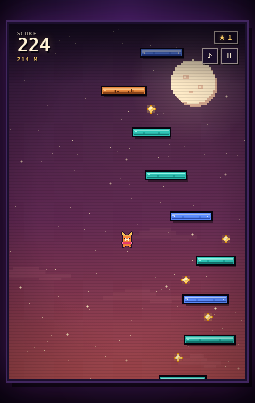

# 像素跳跳乐 · PIXEL LEAP

一个单文件、离线可玩的像素风垂直跳跳乐小游戏。使用原生 Canvas + JavaScript 编写，无外部依赖、无构建步骤。

**在线游玩：** <https://chenjunquan798.github.io/pixel-leap/>

## 玩法

- 角色会自动弹跳，控制左右方向，踩住浮空平台一路向上。
- 收集星星 **+10 分**，掉出屏幕底部则本局结束。
- **黄色弹簧**：踩上去会弹得更高。
- **蓝色平台**：会左右移动。
- **橙色平台**：踩一次后会碎裂。
- 随着高度增加，场景会从「夜幕」进入「霞光层」，再进入「深空」。
- 最高分保存在浏览器本地。

## 操作

| 操作 | 电脑 | 手机 |
| --- | --- | --- |
| 移动 | `←` `→` / `A` `D` | 按住屏幕左右两侧 |
| 开始 / 重开 | `空格` | 点击按钮 |
| 暂停 | `P` / `Esc` | 右上角暂停按钮 |
| 静音 | `M` / `♪` 按钮 | 右上角声音按钮 |

## 技术细节

- 480 × 720 逻辑分辨率 Canvas，整数像素渲染。
- 固定 60 Hz 物理步进，速度与帧率解耦。
- 手写像素精灵、视差星空、月亮与云层。
- WebAudio 合成芯片音效与极轻背景琶音。
- `localStorage` 保存最高分和静音设置。
- 响应式布局，支持键盘与触屏。

## 本地运行

直接下载 `index.html`，双击用现代浏览器（Chrome / Edge / Firefox / Safari）打开即可。

## 文件

- `index.html` — 完整游戏
- `preview.png` — 画面预览
- `.nojekyll` — GitHub Pages 静态托管标记
