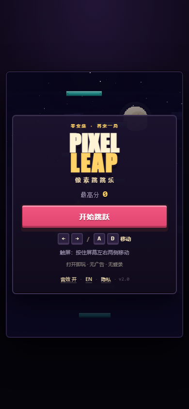
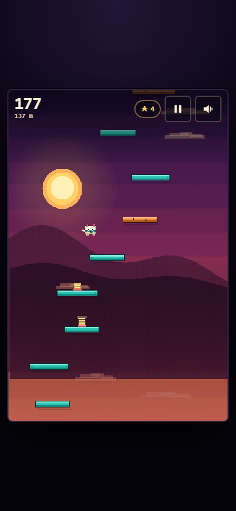
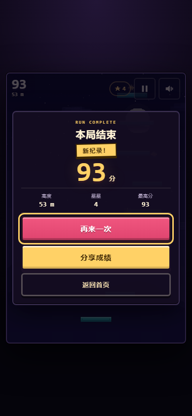

# 像素跳跳乐 · PIXEL LEAP

> 一个打开链接就能玩的像素跳跃小游戏：零安装、零广告、零登录，一局 60 秒，失败也公平。
> v2.0 实现自 PRD v2.0（`像素跳跳乐_PRD_v2.0.md`）的 P0 范围 + 部分 P1。

**在线试玩**：<https://chenjunquan798.github.io/pixel-leap/>
**直接运行**：双击 `index.html`（单文件，无构建产物依赖，离线可玩）





---

## 30 秒上手

| 操作 | 键盘 | 触屏 |
|---|---|---|
| 左右移动 | `←` `→` / `A` `D` | 按住屏幕左 / 右半边，或底部方向键 |
| 开始 / 再来一局 | `空格` / `回车` | 点「开始跳跃」「再来一次」 |
| 暂停 / 继续 | `P` / `Esc` | 右上角暂停键 |
| 静音 | `M` | 右上角喇叭键 |

角色会自动弹跳。踩住平台、顺路吃星星、别掉下去。

---

## 玩法与规则

- **计分**：高度分 = `floor(最高点高度(px) / 8)`，每颗星星 `+10`，总分 = 高度分 + 星星分。下坠不扣分。
- **区域**：0–200 m 夜幕 → 200–500 m 霞光层 → 500 m+ 深空。天空、云层与平台密度一起变化。
- **平台**：普通（青绿）／移动（蓝）／碎裂（橙，先弹一次再碎）／弹簧（黄，一次性高弹）／地面。
- **公平性**（不可谈判）：第一块平台固定在正上方、第一颗星在首跳路径上；垂直间隙 ≤ 跳跃高度的 60%；水平偏移在一次跳跃可覆盖范围内；只从上方判定落地，带 9px 边缘容错；高速下落也不穿透。
- **最高分**：只存本机 `localStorage`，刷新、关站都在；坏了会复位并提示一次。
- **分享**：只有在刷新最高分时出现「分享成绩」；取消 / 不支持 / 出错都会自动复制链接并给出提示。

### 手感参数（与 PRD 8.2 一致）

| 参数 | 值 |
|---|---|
| 逻辑分辨率 / 物理步进 | 480 × 720 / 固定 1/60 s（最多补 5 步） |
| 重力 | 2300 px/s² |
| 普通弹跳 / 弹簧 | 950 / 1520 px/s（跳跃高度 ≈ 196 px） |
| 水平最大速度 | 345 px/s（空中全控制） |
| 垂直间隙 / 水平偏移 | 66–116 px / ±135 px |
| 平台宽度 | 78–104 → 52 px |
| 镜头阈值 / 死亡线 | 屏幕高度 44% / 底部 +110 px |

---

## 项目结构

```
pixel-leap/
├── index.html              # 构建产物：单文件游戏（唯一需要上传的文件）
├── src/                    # 可维护源码
│   ├── core/
│   │   ├── config.js       # 物理与难度常量（改手感只改这里）
│   │   ├── world.js        # 纯模拟：物理、生成、碰撞、计分、镜头
│   │   ├── score.js        # 计分规则
│   │   ├── rng.js          # 确定性随机（同种子同布局）
│   │   └── bot.js          # 机器人：菜单演示 + 300s 爬升测试
│   ├── render/
│   │   ├── palette.js      # 调色板与三区域主题
│   │   ├── background.js   # 离屏天空、视差星/云/远山
│   │   ├── sprites.js      # 角色、平台、星星的整数像素绘制
│   │   └── renderer.js     # 世界渲染、粒子、震屏
│   ├── platform/
│   │   ├── audio.js        # WebAudio 合成音效 + 轻柔琶音
│   │   ├── storage.js      # localStorage 容错读写
│   │   ├── ledger.js       # Plan B 本地账本（零上报）
│   │   └── share.js        # Web Share → 复制兜底
│   ├── ui/
│   │   ├── i18n.js         # 中 / 英文案集中管理
│   │   ├── ui.js           # HUD、覆盖层、toast、焦点、aria-live
│   │   └── sharecard.js    # 1200×630 动态分享卡（默认不打包）
│   ├── main.js             # 状态机与主循环
│   └── index.template.html # HTML 骨架（构建时注入 CSS/JS）
├── styles.css              # DOM 层样式
├── build.mjs               # 零依赖构建：模块 → 单文件
├── tests/                  # node:test 测试（42 项）
├── tools/                  # 开发工具（截图验证、OG 图生成）
├── assets/                 # OG 图与 PWA 图标
├── privacy.html            # 隐私与无障碍说明
├── manifest.webmanifest / sw.js / robots.txt / sitemap.xml
└── docs/superpowers/       # 实现计划
```

---

## 开发

需要 Node.js ≥ 22（仅用于构建与测试，运行游戏不需要任何依赖）。

```bash
node build.mjs            # 生成 index.html（默认 ≤80KB 构建）
node build.mjs --with-card # 额外打包 1200×630 动态分享卡（约 +5KB）
node --test "tests/*.test.mjs"
node build.mjs && node --test "tests/*.test.mjs"   # 提交前完整检查
```

本地预览（任选）：

```bash
python -m http.server 8123     # 然后打开 http://127.0.0.1:8123
npx serve .
```

> 直接用 `file://` 打开 `index.html` 也能玩，只是 Service Worker 不会注册。

### 构建做了什么

- 按依赖顺序读取 `src/**`，去掉 `import` / `export`，每个模块包进独立 IIFE 后拼接；
- 内联 `styles.css` 与所有脚本到 `src/index.template.html` 的占位符；
- 保守压缩：去注释、去缩进、压空白（保留字符串与正则原样），不改变语义；
- 输出唯一交付物 `index.html`。

`tests/build.test.mjs` 会检查包体、零第三方请求、SEO 元数据、无障碍骨架与 PRD 文案，构建超标直接失败。

---

## 包体与性能

| 指标 | 目标（PRD） | 当前 |
|---|---|---|
| 单文件 | ≤80 KB（gzip 前） | **77 KB**（gzip ≈ 26 KB） |
| 第三方请求 | 0 | **0**（无脚本 / 样式 / 字体 / 图片请求） |
| 内联 JS | ≤80 KB | **≈ 62 KB** |
| 首屏 | 1.2s 内可交互 | 无网络请求，HTML 直出即菜单；无 spinner |
| 帧率 | p95 ≤16.7ms | 固定 60Hz 物理 + 一次 draw；低端机自动降级 |

**为什么默认不打包动态分享卡**：PRD 11.6 规定「HTML + 必要资源 gzip 前 ≤80KB，超过即放弃该 P1，按 动态分享图 → 英文界面 → PWA → 皮肤 的顺序砍」。加入动态分享卡会把包体推到 ≈82KB，因此默认构建按 PRD 把这一项砍掉，分享仍走 P0 的「Web Share / 复制链接」路径，社交预览由静态 `assets/og-image.png` 负责。需要动态分享图时运行 `node build.mjs --with-card` 即可，代码完整保留在 `src/ui/sharecard.js`。

---

## 测试

```bash
node --test "tests/*.test.mjs"
```

| 文件 | 覆盖 |
|---|---|
| `physics.test.mjs` | 跳跃高度 196px、1500px/s 不穿透、9px 容错、只从上方落地、同时按左右抵消、镜头只上不下、死亡线 |
| `generation.test.mjs` | 首块平台居中、首星可达、前 420px 无特殊平台、同种子可复现、间隙/宽度/偏移上限、难度递增、星星可达 |
| `robot.test.mjs` | **300 秒机器人爬升**：不死亡、不卡死、高度持续增长、无不可达平台、固定步进可复现 |
| `score.test.mjs` | 8px=1m、星星 +10、下坠不扣分、平局不算新纪录、大数精度 |
| `storage.test.mjs` | 损坏 JSON 复位、非法字段清洗、只增不减、隐私模式不阻断、账本 200 条上限 |
| `i18n.test.mjs` | 中英 key 一致、无遗留占位符、分享文案无 PII、区域名 |
| `build.test.mjs` | 包体、语法、零第三方请求、SEO、aria-live/按钮类型、PRD 文案、资源存在 |

真实浏览器验证（需要本机 Edge）：

```bash
python -m http.server 8123
node tools/cdp.mjs "http://127.0.0.1:8123/index.html" build/shots --w=390 --h=844 --prefix=mobile
node tools/zones.mjs "http://127.0.0.1:8123/index.html" build/shots --w=390 --h=844
```

`tools/cdp.mjs` 会走一遍「菜单 → 开始 → 输入 → 暂停 → 继续 → 结算 → 分享取消兜底 → 切换英文」，并输出 console 错误、HUD 文本、aria-live 播报与焦点位置。`tools/zones.mjs` 用机器人把游戏推进到三个区域并截图。

---

## 无障碍（WCAG 2.2 AA · 核心 UI）

- 菜单、暂停、结算、分享全部是真实 `<button>`，Tab 顺序符合阅读顺序，`:focus-visible` 有 3px 金色描边。
- `aria-live="polite"` 只在状态切换时播报，文案与 PRD 10.2 一致；结算包含分数、高度、星星、最高分与新纪录。
- 支持 `prefers-reduced-motion`：关闭震屏、粒子减半、区域过渡即时；**不会**因此静音。
- 文字对比度 ≥4.5:1，触控目标 ≥44×44px，320px 宽与 200% 缩放不丢功能。
- **已知边界**：Canvas 内的平台 / 星星 / 角色无法被屏幕阅读器逐项描述，完全非视觉玩家无法独立完成核心循环。这一点写在 `privacy.html` 里，不包装成「已完全无障碍」。

---

## 隐私（Plan B：零上报）

- 无 Cookie、无第三方脚本、无广告、无账号、无网络上报；游戏运行时请求数为 0。
- 只写一个 `localStorage` 键 `pixelLeap.v2`：最高分、静音、语言、最近 200 条本地局记录（含分数、高度、星星、时长、区域）。
- 分享必须由玩家主动触发，链接只带 `?ref=share`，不含任何标识。
- 本地记录可通过控制台导出（不联网）：

```js
PixelLeap.exportLedger()   // 返回 JSON 字符串
PixelLeap.summary()        // { events, sessions, runs, best, avgScore, shares }
PixelLeap.state            // { mode, best, muted, lang, score }
```

详见 [`privacy.html`](privacy.html)。

---

## PRD P0 对照

| ID | 需求 | 状态 | 落点 |
|---|---|---|---|
| FR-01 | 首屏直接进菜单、无 spinner | ✅ | 单文件 + 内联 CSS/JS，0 请求 |
| FR-02 | 单一主 CTA，点击/Enter/空格开始 | ✅ | `main.js` 输入绑定 |
| FR-03 | 键盘 + 触屏，50ms 响应、不滚动 | ✅ | `touch-action:none`、pointer capture |
| FR-04 | 自动弹跳、只从上方落地、9px 容错、不穿透 | ✅ | `world.js` 横扫碰撞 + 解析积分；测试覆盖 |
| FR-05 | 普通/移动/碎裂/弹簧/地面 | ✅ | `world.js` 生成、`sprites.js` 三重编码 |
| FR-06 | 星星 +10，20/24px 收集判定 | ✅ | `world.js` |
| FR-07 | 镜头只向上、难度递增、200/500m 区域 | ✅ | `world.js` + `palette.js` |
| FR-08 | 坠落 +110px 结算，一键重开 | ✅ | `main.js` / `ui.js` |
| FR-09 | 最高分与静音持久化，损坏可解释 | ✅ | `storage.js` + 一次性 toast |
| FR-10 | P/Esc/按钮/切后台暂停，恢复不补帧 | ✅ | `main.js` visibilitychange |
| FR-11 | 手势后初始化音频，静音持久化，失败不阻断 | ✅ | `audio.js` |
| FR-12 | 320px 起可用、触区 ≥44px、低端降级 | ✅ | CSS clamp + 3 秒慢帧自动降级 |
| FR-13 | 键盘可达、焦点可见、aria-live、减弱动效 | ✅ | `ui.js` + CSS |
| FR-14 | 仅新纪录分享，非成功必复制兜底 | ✅ | `share.js`（取消路径已实测） |
| FR-15 | 标题/描述/canonical/OG/Twitter/JSON-LD | ✅ | `index.html` 头部 + `assets/og-image.png` |
| FR-16 | Plan B：零上报，本地调试与导出 | ✅ | `ledger.js` + `PixelLeap.exportLedger()` |

P1 完成 2 项：**PWA / 离线缓存**（`sw.js` + manifest）、**英文界面**（可切换 / `?lang=en`）。动态分享卡按包体门禁默认关闭，可用构建开关打开；每日挑战、触觉反馈、皮肤未实现（PRD 允许后置）。

---

## 已知边界与后续

- 无障碍：Canvas 内容不可被辅助技术逐项读取（见上）。
- 没有排行榜、账号、多人：与 PRD 非目标一致。
- Plan B 下没有 D1/D7 统计：只有本地账本与人工面板，不声称统计显著。
- `sw.js` 的缓存版本号需要随发布手改（`CACHE` 常量）。

## 许可

游戏代码与美术均为本项目原创，MIT License。像素猫、平台、星空全部用 Canvas / PIL 程序化绘制，无第三方素材或字体。
